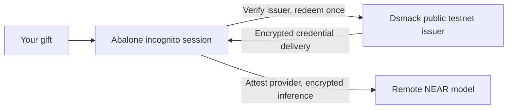

# Abalone

Abalone is a curated skill that guides you into an incognito AI session.
The [Abalone incognito skill](skills/abalone-incognito/SKILL.md) prepares the
reviewed reference helper and hands its interactive terminal to you. Bring a
gift, review its terms, and connect directly to an admitted inference provider.
Dsmack handles redemption; Abalone guides first use and close.

The skill is instructions for a setup agent, not the privacy mechanism. The
current reference implementation downloads a distribution built around a
patched Pi agent; adding this skill to stock Pi or Hermes does not supply it.

| Component | What it does |
| --- | --- |
| Outside setup skill | Checks support, prepares the reviewed helper and hands the terminal to you |
| Abalone reference helper | Launcher, patched Pi, curated extensions, verification and credential broker |
| Local host | First release trusts the owned host; bubblewrap containment is milestone 2 |
| Dsmack / remote NEAR | Coupon redemption / admitted encrypted inference |

This remains a substantial runtime and dependency boundary; a skill entry does
not reduce its trusted code or qualify other agent hosts.



## Use the skill

The friend release is **being prepared**. There is no qualified public download
yet, and the new skill-first handoff is not yet rehearsed. The
[friend-URL acceptance issue](https://github.com/amiller/abalone/issues/4)
tracks the reviewed artifact, public acquisition and actual walkthrough. Do not
use an old trial bundle merely because it appears on a release page.

Supported recipient: **Linux x86_64, compatible Node 24, bash, curl, tar and
sha256sum**, running as an ordinary user with an existing Linux tmpfs. The first
release selects an explicit trusted-owned-host profile with **no OS isolation**;
local tools have your ordinary account filesystem/network access. Bubblewrap
containment and portable setup belong to milestone 2 after this release. macOS, Windows, Docker containers and USB/Tails are not
qualified recipient profiles for this release. No VPN, provider account, manual
API key or funded recipient wallet is required.

Once the public entry is ready, ask your setup agent to use the linked skill.
It prepares the exact helper if needed, then steps aside before hidden input;
you operate the private session yourself. Do not send the agent your coupon,
passphrase or private prompts. A same-user setup agent stepping aside supplies
cooperation, not enforced privacy from that agent or your administrator.

The release will provide one reviewed `install.sh`, its SHA256 and the public
trial files it pins. These are the implementation of the skill's setup step,
not an additional service/account to sign up for. The equivalent manual entry
after downloading, inspecting and verifying the installer is:

```sh
sh install.sh --friend
```

This downloads the pinned reference distribution and creates a fresh private
workspace/session. Compatible Node and the selected owned-host memory prerequisites are checked;
the installer does not silently turn another agent into this runtime.
Enter your gift at the hidden prompt, never in arguments, shell history,
environment values or an AI message. Read the offer before claiming. Keep the
same window open while delivery is pending; it holds the recipient keys needed
for delivery. A terminal reconciliation error is not permission to redeem again.

Session-only use is the default: no upfront trace passphrase and no durable
managed prompt/response trace. To
deliberately retain an encrypted trace:

```sh
sh install.sh --friend --keep-trace
```

The passphrase protects retained local traces, not the coupon. Enter it at the
hidden prompt, never in chat, arguments or environment values. Keep it if you
want to open the trace later: the passphrase is user-held, a lost one can leave
the retained trace unreadable, and no recovery for it is qualified. Trace
choice never disables inference encryption or provider verification. Workspace
files you create can remain after close; session-only does not mean secure
erasure. These release interfaces are candidates until acceptance passes.

## Understand the session

The first trial uses **remote NEAR inference**. A local credential broker does not make the model local. Redemption creates a provider-capped credential: a $1
cap is not a segregated purse, wallet transfer or verified remaining balance.
The sponsor/provider can revoke the credential and its model access, provider
caps can overshoot, and remaining credit is unknown unless verified usage is
available. Attestation and encryption on that inference connection are verified
by the helper itself, not by this skill or your setup agent.

The selected Dsmack issuer runs through the native Mac runner and an ordinary
local Apple Containerization ARM guest on the Mac mini, without a project cloud
CVM. Mac admission verifies Apple App Attest code identity, exact compose and
fresh issuer-key/policy bindings. It does not put the workload in Intel TDX or
Secure Enclave custody: the host/operator and stand-in KMS can read issuer
secrets. The new Mac workload integration and public friend URL remain pending;
existing Apple primitive and Linux-client checks do not establish that journey.

Use `/coupon` for session and trust details. Normal close clears the process's
recipient key and credential references; it does not revoke the provider key or
guarantee erasure against a privileged host. Admission renewal uses the same
live credential through normal verification, never another coupon. Closed-session
recovery is not qualified. Diagnostics are deliberate and metadata-only by
default; never post a gift, key, private prompt or raw trace to an issue.

Ask about a document from inside the session with an at-mention: type
`Summarize @notes.txt`, or `@"meeting notes.txt"` when the name has spaces;
trailing punctuation is not part of the name. Abalone reads the named file on
your computer and puts its text into the encrypted model request, not
setup-agent chat. Do not paste document contents into chat, arguments,
environment values or logs yourself. If a selected file cannot be read or extracted, the request is refused before
inference. PDF reading is not qualified in this preview; use
plain text files.

This trial permits **synthetic, non-sensitive prompts only**. Its explicit
firmware-warning profile can admit verified `OutOfDate` gateway/model platforms;
actual warnings precede effects. Encryption and attestation remain required, but
this exception does not establish strong private guarantees. The issuer operator
may know, use or revoke the key. Base `safe` confirmation trusts the configured
RPC; it is not independent Ethereum L1 finality. Private issuer custody, rollback
protection, anonymous funding and full production release are unqualified.
Incognito does not provide IP anonymity or protection from your host administrator.

## Develop or review

- [Gift trial and exact public inputs](docs/coupon-first-use.md)
- [Preparing the friend release](docs/friend-release.md)
- [Contributing and building](CONTRIBUTING.md)
- [Development workflow](docs/development.md)
- [Roadmap](docs/roadmap.md) and [feedback tracker](https://github.com/amiller/dsmack/issues/47)
- [Threat model](docs/threat-model.md) and [security reporting](SECURITY.md)

First-party code is [MIT licensed](LICENSE); [component notices](THIRD_PARTY_NOTICES.md)
remain applicable. Source publication, installable-release and live-service
qualification are distinct. The issuer service and operator credentials are not
part of the recipient package.
