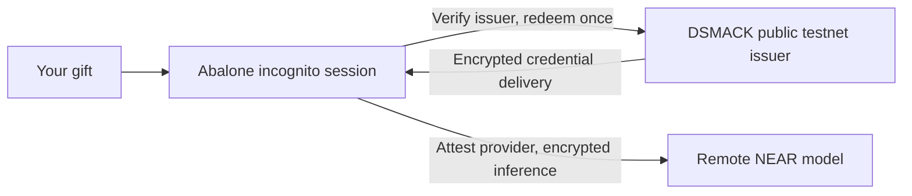

# Abalone

Abalone is a curated guide to an incognito AI session, built around a minimally
patched Pi agent. Bring a gift, review its terms, and connect directly to an
admitted inference provider. DSMACK handles redemption; Abalone guides first use
and close.



## Try a gift

The friend release is **being prepared**. There is no qualified public download
yet. The [friend-URL acceptance issue](https://github.com/amiller/abalone/issues/4)
tracks the reviewed artifact, public acquisition and actual walkthrough. Do not
use an old trial bundle merely because it appears on a release page.

Supported recipient: **Linux x86_64, Node 24, bash, bubblewrap, curl, tar and
sha256sum**, running as an ordinary user. Bubblewrap needs working user and
network namespaces. macOS, Windows, Docker containers and USB/Tails are not
qualified recipient profiles for this release. No VPN, provider account, manual
API key or funded recipient wallet is required.

The prepared release will provide one reviewed `install.sh`, its SHA256 and the
public trial files it pins. Download and inspect it, verify its published
checksum, then run:

```sh
sh install.sh --friend
```

This installs the pinned client and creates a fresh private workspace/session.
Enter your gift at the hidden prompt, never in arguments, shell history,
environment values or an AI message. Read the offer before claiming. Keep the
same window open while delivery is pending; it holds the recipient keys needed
for delivery. A terminal reconciliation error is not permission to redeem again.

Session-only use is the planned default: no upfront trace passphrase and no
durable prompt/response trace. To deliberately retain an encrypted trace:

```sh
sh install.sh --friend --keep-trace
```

The passphrase protects retained local traces, not the coupon. Keep it if you
want to open the trace later; losing it can make the trace unreadable. Trace
choice never disables inference encryption or provider verification. Workspace
files you create can remain after close; session-only does not mean secure
erasure. These release interfaces are candidates until acceptance passes.

## Understand the session

The first trial uses **remote NEAR inference**. A local broker/tool sandbox does
not make the model local. Redemption creates a provider-capped credential: a $1
cap is not a segregated purse, wallet transfer or verified remaining balance.
The sponsor/provider can revoke access, provider caps can overshoot, and
remaining credit is unknown unless verified usage is available.

Use `/coupon` for session and trust details. Normal close clears the process's
recipient key and credential references; it does not revoke the provider key or
guarantee erasure against a privileged host. Admission renewal uses the same
live credential through normal verification, never another coupon. Closed-session
recovery is not qualified. Diagnostics are deliberate and metadata-only by
default; never post a gift, key, private prompt or raw trace to an issue.

This trial permits **synthetic, non-sensitive prompts only**. Its explicit
firmware-warning profile can admit verified `OutOfDate` gateway/model platforms;
actual warnings precede effects. Encryption and attestation remain required, but
this exception does not establish strong private guarantees. The issuer operator
may know, use or revoke the key. Base `safe` confirmation trusts the configured
RPC; it is not independent Ethereum L1 finality. Private issuer custody, rollback
protection, anonymous funding and full production release are unqualified.
Incognito does not provide IP anonymity or protection from your host administrator.

## Develop or review

- [Gift trial and exact public inputs](docs/coupon-first-use.md)
- [Preparing the friend release](docs/friend-release.md)
- [Contributing and building](CONTRIBUTING.md)
- [Development workflow](docs/development.md)
- [Roadmap](docs/roadmap.md) and [feedback tracker](https://github.com/amiller/dsmack/issues/47)
- [Threat model](docs/threat-model.md) and [security reporting](SECURITY.md)

First-party code is [MIT licensed](LICENSE); [component notices](THIRD_PARTY_NOTICES.md)
remain applicable. Source publication, installable-release and live-service
qualification are distinct. The issuer service and operator credentials are not
part of the recipient package.
